# ha-garden-card

[](https://www.home-assistant.io/integrations/marketplace/)
[](https://github.com/juju35/ha-garden-card/actions/workflows/hacs.yml)
[](https://github.com/juju35/ha-garden-card/actions/workflows/validate.yml)
[](https://github.com/juju35/ha-garden-card/actions/workflows/lint.yml)
[](https://github.com/juju35/ha-garden-card/releases/latest)
[](https://github.com/juju35/ha-garden-card/blob/main/LICENSE)
[](https://buymeacoffee.com/julienstep9)

Lovelace cards for Home Assistant for the garden: **watering zones** (valves and switches of [Gardena](https://www.gardena.com), [Rain Bird](https://www.rainbird.com), [OpenSprinkler](https://opensprinkler.com), [Hunter Hydrawise](https://www.hunterindustries.com/hydrawise), [LinkTap](https://www.link-tap.com), [Rachio](https://rachio.com), [Orbit B-hyve](https://bhyve.orbitonline.com), or any valve or switch) with an animated countdown and a timed start, the **next watering**, **plants** with gauges and thresholds (the [plant](https://www.home-assistant.io/integrations/plant/) integration, Mi Flora and other plant sensors), **soil moisture**, and a **"no watering needed, rain expected"** suggestion from the rain forecast of your weather entity.

Zones, plants, soil sensors and the weather entity are **discovered automatically** from the Home Assistant registries: an empty configuration already shows your garden, whatever your Home Assistant language or entity ids. Each of them can also be listed in the configuration, with its own options.

[](https://my.home-assistant.io/redirect/marketplace_repository/?owner=juju35&repository=ha-garden-card&category=plugin)

| Garden Card | Garden Mini Card |
|---|---|
|  | 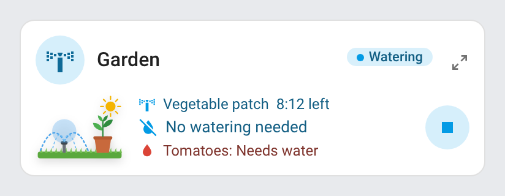<br>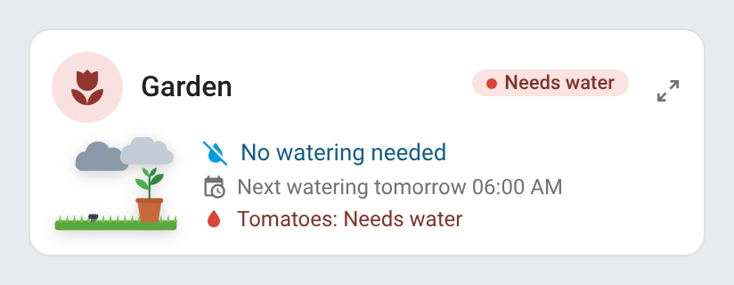 |

## Features

- Two cards: a full **Garden Card** (`custom:garden-card`) and a compact **Garden Mini Card** (`custom:garden-mini-card`)
- Drawn garden (lawn, pop-up sprinkler, potted plant, sky) animated by what goes on: the sprinkler sprays while a zone waters, a cloud rains when watering is not needed, the plant wilts under a burning sun when one of your plants is thirsty (see [Animations](#animations))
- Header icon in a tinted round badge, in the color of the garden's state (blue watering, red a plant needs water, orange a plant needs attention, green all fine), and a status chip on the title's line
- **Watering zones**: state, next run, soil moisture of the zone, and while it waters a ring that counts down second by second with water spraying from the zone's icon; **Start** opens a popup at the top of the card to pick the duration (presets 5 to 60 min, or minute by minute), **Stop** ends the run
- Each integration is started its own way (Rain Bird, Rachio and B-hyve services in minutes, Gardena smart system and OpenSprinkler in seconds, Hydrawise on its watering sensor, the watering duration number of LinkTap and Gardena Bluetooth), or with a script of your own (see [Starting a zone](#starting-a-zone))
- **Next watering**: the earliest next run of the zones (Hydrawise next cycle, any timestamp sensor) or of the entity you pick (a timestamp sensor, an `input_datetime` or a calendar)
- **Rain suggestion**: "No watering needed" when the rain expected over the next 24 h reaches 2 mm, when rain is likely (70 % and more) or when it rains now, else the rain expected (or "no rain expected"); the thresholds and the window are options
- **Plants**: moisture, fertility (conductivity), light, temperature and battery as gauges, the green band showing the plant's thresholds; a plant that needs water turns red with a pulsing drop
- Thresholds from the plant's own settings (the Plant Monitor threshold numbers), your configuration, or sensible defaults (those of the plant integration for moisture and fertility)
- **Soil moisture** sensors as gauges too
- Collapsible sections (zones, plants, soil moisture), folded back to their defaults by a click elsewhere on the page
- Detail button on the mini card (top right): it switches the mini card to the full card's content and back; a click anywhere outside the card brings the compact view back
- Click any value to open its Home Assistant history (more-info dialog)
- Visual editor in the dashboard UI for both cards (no YAML needed)
- Light and dark mode, English, French, German, Spanish, Serbian (Cyrillic and Latin), Italian, Dutch, European Portuguese, Polish, Romanian, Danish, Swedish, Bulgarian, Russian, Ukrainian, Hungarian, Slovak, Czech, Slovenian, Latvian and Greek
- Single file, no external dependency, the drawings are embedded

## Supported integrations

| Integration | Devices | What the cards use |
|---|---|---|
| [Gardena smart system](https://github.com/py-smart-gardena/hass-gardena-smart-system) (custom, `gardena_smart_system`) | Water Control, Irrigation Control | Valves (zones), started with `gardena_smart_system.valve_open` and the chosen duration |
| [Gardena Bluetooth](https://www.home-assistant.io/integrations/gardena_bluetooth/) (core) | Water Control Bluetooth, soil moisture sensor | Valve, started for the chosen duration with its *Open for* number (else its manual watering time number, set before opening); remaining time, soil moisture |
| [Rain Bird](https://www.home-assistant.io/integrations/rainbird/) (core) | Rain Bird controllers | Zone switches, started with `rainbird.start_irrigation` |
| [OpenSprinkler](https://github.com/vinteo/hass-opensprinkler) (custom, `opensprinkler`) | OpenSprinkler controllers | Stations (`…_station_enabled` switches, master station left out, state from `…_station_running`), started with `opensprinkler.run_station`, stopped with `opensprinkler.stop` |
| [Hunter Hydrawise](https://www.home-assistant.io/integrations/hydrawise/) (core) | Hydrawise controllers | Zone valves, started with `hydrawise.start_watering` on the zone's watering sensor; next cycle and remaining watering time |
| [LinkTap](https://github.com/sh00t2kill/linktap_local_http_component) (custom, `linktap`) | LinkTap taps | Valve, started with `linktap.start_watering`; its watering duration number as the default, remaining and total duration |
| [Rachio](https://www.home-assistant.io/integrations/rachio/) (core) | Rachio controllers | Zone switches (not standby, rain delay or schedules), started with `rachio.start_watering` |
| [Orbit B-hyve](https://github.com/sebr/bhyve-home-assistant) (custom, `bhyve`) | B-hyve timers and controllers | Zone valves (4.x; zone switches of 3.x), started with `bhyve.start_watering` |
| Any other valve or switch | ESPHome sprinkler, Zigbee water valves, smart plugs on a pump… | Listed in `zones`: opened and closed; a duration with a duration number of its device or your own script |
| [Plant](https://www.home-assistant.io/integrations/plant/) (core) and [Plant Monitor](https://github.com/Olen/homeassistant-plant) (custom) | Plants | Readings, the integration's problem verdict, and the Plant Monitor threshold numbers |
| [Xiaomi BLE](https://www.home-assistant.io/integrations/xiaomi_ble/) and other plant sensors | Mi Flora, Flower Care, Zigbee plant sensors | Devices with soil moisture plus fertility or light become plants |
| Any [weather](https://www.home-assistant.io/integrations/weather/) entity | Met.no, Météo-France, OpenWeatherMap… | Hourly (else twice daily or daily) forecast: precipitation and its probability |

The zones of these integrations are found on their own; other valves and switches (a main water shutoff valve is a valve too) are only shown when listed in `zones`. Details in [How it works](#how-it-works).

## Prerequisites

Home Assistant 2024.8 or later, with at least a watering zone, a plant, a soil moisture sensor or a weather entity.

## Installation

### Via the Marketplace (recommended)

Click the button below to add the repository directly:

[](https://my.home-assistant.io/redirect/marketplace_repository/?owner=juju35&repository=ha-garden-card&category=plugin)

Then click **Install**, and reload your browser when the Marketplace asks you to.

Or manually:

1. Open **Settings → Marketplace → Add from link** (top right; this needs a GitHub account connected)
2. Add `https://github.com/juju35/ha-garden-card` — Type: **Dashboard**
3. Open **Garden Card** and click **Install**
4. Clear your browser cache and refresh

The Marketplace adds the resource `/local/community/ha-garden-card/garden-card.js` for you.

### Manual

1. Download `garden-card.js` and the `garden-card.i18n.*.js` translation files from the [latest release](https://github.com/juju35/ha-garden-card/releases/latest)
2. Copy them all to `/config/www/` (without the translation files, the cards show in English)
3. Go to **Settings → Dashboards → ⋮ → Resources** → Add resource:
   - URL: `/local/garden-card.js`
   - Type: **JavaScript Module**
4. Clear your browser cache and refresh

## Configuration

### Card types

| Card | Type |
|---|---|
| Garden Card | `custom:garden-card` |
| Garden Mini Card | `custom:garden-mini-card` |

### Visual editor

Edit a dashboard, click **Add card** and search for **Garden Card** or **Garden Mini Card**. Everything is discovered when the lists are left empty; pick zones (valves, switches), plants, plant sensor devices and soil moisture sensors to show only those, choose the weather entity, the rain thresholds, the default watering duration, the sections and the language. The preview updates live, and options left at their default are kept out of the generated YAML; options of a zone or a plant written in YAML (name, duration, thresholds…) are kept when the lists are edited.

### Minimal

```yaml
type: custom:garden-card
```

```yaml
type: custom:garden-mini-card
```

### Full options

```yaml
type: custom:garden-card
title: Backyard
weather: weather.home
rain_threshold: 3
rain_probability: 80
rain_window: 24
default_duration: 15
next_run: calendar.watering
zones:
  - valve.lawn
  - entity: switch.rain_bird_sprinkler_1
    name: Hedge drip line
    duration: 30
  - entity: switch.drip_pump
    name: Greenhouse
    script: script.timed_watering
    moisture: sensor.greenhouse_soil_moisture
plants:
  - plant.basil
  - device: Tomatoes
    min_moisture: 25
    max_moisture: 55
  - name: Lemon tree
    moisture: sensor.lemon_moisture
    conductivity: sensor.lemon_conductivity
    illuminance: sensor.lemon_illuminance
    temperature: sensor.lemon_temperature
    image: /local/lemon.jpg
moisture_sensors:
  - sensor.lawn_soil_moisture
  - entity: sensor.bed_soil_moisture
    min: 30
    max: 70
show_title: true
show_subtitle: true
show_weather: true
show_zones: true
show_plants: true
show_soil: true
collapsed:
  - soil
language: en
```

```yaml
type: custom:garden-mini-card
weather: weather.home
zoom: true
language: en
```

### Options reference

| Option | Card | Default | Description |
|---|---|---|---|
| `title` | both | Garden | Card title |
| `show_title` | both | `true` | Show the title in the header |
| `show_subtitle` | full | `true` | Show the subtitle (next watering, or the number of zones and plants) |
| `zones` | both | Automatic | Watering zones: entity ids of valves or switches, or objects (see [Zone options](#zone-options)); empty or absent, the zones of the [supported integrations](#supported-integrations) |
| `plants` | both | Automatic | Plants: `plant.*` entity ids, devices (`device:` its name or id) or plants made of sensors (see [Plant options](#plant-options)); absent, every plant entity and every plant sensor device |
| `moisture_sensors` | full | Automatic | Soil moisture sensors: entity ids, or objects with `entity`, `name`, `min` and `max` (default 20–60 %); absent, the moisture sensors of no plant and no zone |
| `weather` | both | First weather entity | Weather entity whose forecast gives the rain expected; `none` for no rain suggestion |
| `rain_sensor` | both | — | Sensor giving the rain expected over the window (in its unit, mm by default), used instead of the forecast amount (e.g. a Météo-France or OpenWeatherMap rain sensor) |
| `rain_threshold` | both | `2` | Rain expected over the window from which watering is not needed, in the forecast's unit (mm, or in) |
| `rain_probability` | both | `70` | Rain probability (%) from which watering is not needed, when some rain is expected |
| `rain_window` | both | `24` | Forecast window, in hours |
| `next_run` | both | — | Entity of the next watering: a timestamp sensor, an `input_datetime` or a calendar (start of its next event); the earliest of it and of the zones' next runs is shown |
| `default_duration` | both | `10` | Duration preselected in the Start popup, in minutes (a zone's `duration`, else its device's duration number, comes first) |
| `show_weather` | both | `true` | Rain suggestion (and the forecast subscription) |
| `show_zones` | full | `true` | Watering zones section |
| `show_plants` | full | `true` | Plants section |
| `show_soil` | full | `true` | Soil moisture section |
| `collapsed` | full | `[]` | Sections folded by default, among `zones`, `plants` and `soil`. Click a section title (or Tab to it and press Enter or Space) to fold or unfold it |
| `zoom` | mini | `true` | Detail button at the top right of the mini card: it shows the full card's content (with the same options) and switches back to the compact view; a click outside the card also brings the compact view back. `false` removes the button |
| `language` | both | Auto | Force language: `fr`, `en`, `de`, `es`, `sr`, `sr-Latn`, `it`, `nl`, `pt`, `pl`, `ro`, `da`, `sv`, `bg`, `ru`, `uk`, `hu`, `sk`, `cs`, `sl`, `lv` or `el` (auto-detects from HA settings) |

### Zone options

| Option | Description |
|---|---|
| `entity` | The valve or switch of the zone (required) |
| `name` | Name shown (default: the entity's name) |
| `duration` | Duration preselected in the Start popup, in minutes |
| `script` | Script that starts the zone instead of the integration: called with the variables `zone` (the entity id) and `minutes` |
| `remaining` | Sensor of the time left: a duration (s, min or h, counted from its last update) or a timestamp of the end |
| `total` | Sensor of the length of the current run (for the ring) |
| `next_run` | Timestamp sensor of the zone's next run |
| `duration_entity` | Number entity set to the duration before opening the zone (unit read from the entity) |
| `open_for` | Gardena Bluetooth: the *Open for* number (minutes) that opens the valve for the duration |
| `watering` | Binary sensor telling the zone waters (Hydrawise: the target of `hydrawise.start_watering`) |
| `running` | Binary sensor used as the zone's state instead of the entity's own (OpenSprinkler: `…_station_running`) |
| `moisture` | Soil moisture sensor of the zone, shown on its line |

Every helper left out is looked for on the zone's device (when the device holds that one zone), by its name: *remaining*, *total duration*, *next*, *duration* / *watering time*, *watering*, Gardena Bluetooth's *Open for*, and the moisture sensor.

### Plant options

| Option | Description |
|---|---|
| `entity` | A `plant.*` entity (the plant integration or Plant Monitor) |
| `device` | A device (its name or id) whose sensors make the plant (Mi Flora…) |
| `name` | Name shown |
| `image` | Picture of the plant (default: the plant entity's picture) |
| `moisture`, `conductivity`, `illuminance`, `temperature`, `battery` | Sensors, for a plant made of sensors or to replace one |
| `min_moisture`, `max_moisture`, `min_conductivity`, `max_conductivity`, `min_illuminance`, `max_illuminance`, `min_temperature`, `max_temperature`, `min_battery` | Thresholds |

Default thresholds: those of the plant integration, moisture 20–60 %, fertility 500–3000 µS/cm, battery 20 %. Light and temperature have no default (the plant integration checks light against the day's maximum, so a threshold on the current light would warn every night): set them with the options above, or they come from Plant Monitor's numbers. A plant whose moisture is under its minimum is shown in red (it needs water), other readings out of their range in orange.

### Starting a zone

The Start button opens a popup at the top of the card with the duration (presets of 5, 10, 15, 20, 30, 45 and 60 minutes, and − / + buttons, up to the integration's limit), then:

| Zone | Call |
|---|---|
| With `script` | `script.turn_on` with `variables: { zone, minutes }` |
| Gardena smart system | `gardena_smart_system.valve_open` with `duration` in seconds (whole minutes, 1 to 240) |
| Rain Bird | `rainbird.start_irrigation` with `duration` in minutes (1 to 1440) |
| OpenSprinkler | `opensprinkler.run_station` with `run_seconds` (up to 18 h) |
| Hydrawise | `hydrawise.start_watering` with `duration` in minutes, on the zone's watering binary sensor |
| Rachio | `rachio.start_watering` with `duration` in minutes (up to 180, the Rachio limit) |
| LinkTap | `linktap.start_watering` with `seconds` (up to 1439 minutes) |
| Orbit B-hyve | `bhyve.start_watering` with `minutes` |
| Gardena Bluetooth | `number.set_value` on its *Open for* number, in minutes |
| With a duration number (`duration_entity`, Gardena Bluetooth without *Open for*) | `number.set_value` (in the number's unit), then `valve.open_valve` / `switch.turn_on` |
| Other valve or switch | `valve.open_valve` / `switch.turn_on`, without popup: it runs until stopped (or until its own timer ends) |

Stop closes the valve (`valve.close_valve`), turns the switch off, or calls `opensprinkler.stop`. The buttons are disabled while the zone is unavailable.

## Screenshots

### Animations

The garden is drawn, and animates to match what goes on; it settles back to a still picture when nothing happens. Each state plays its own animation, and every one of them honours `prefers-reduced-motion`.

While a zone waters, the pop-up sprinkler sprays its water arcs, drops fall and the grass sways; the zone's ring counts down with water spraying from its icon:

| Light | Dark |
|---|---|
| 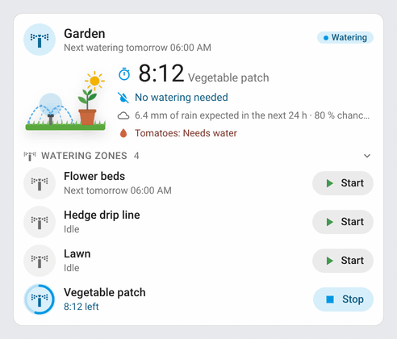 | 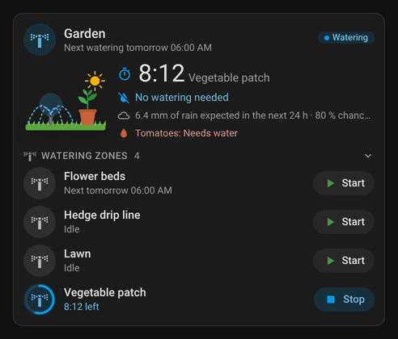 |

When rain is expected (or it rains now), watering is not needed: a cloud drifts and rains over the garden:

| Light | Dark |
|---|---|
| 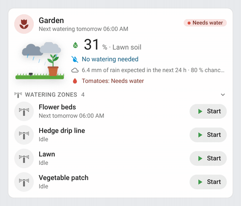 | 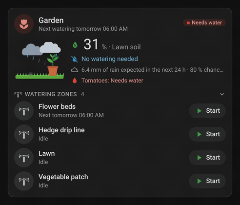 |

When a plant lacks water, it wilts under a burning sun, and its moisture drop pulses:

| Light | Dark |
|---|---|
| 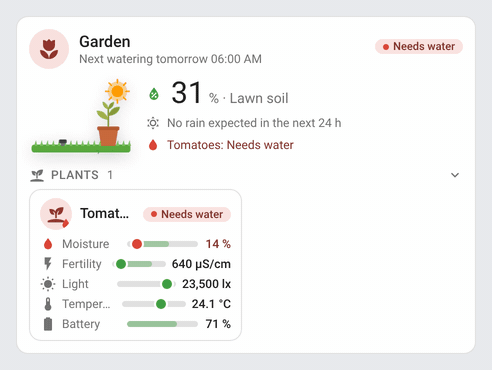 | 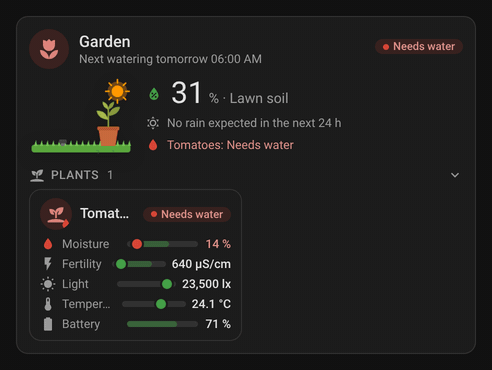 |

### Full card

The vegetable patch waters (8 min left of its 15 min run), rain is expected, the tomatoes need water:

| Light | Dark |
|---|---|
|  | 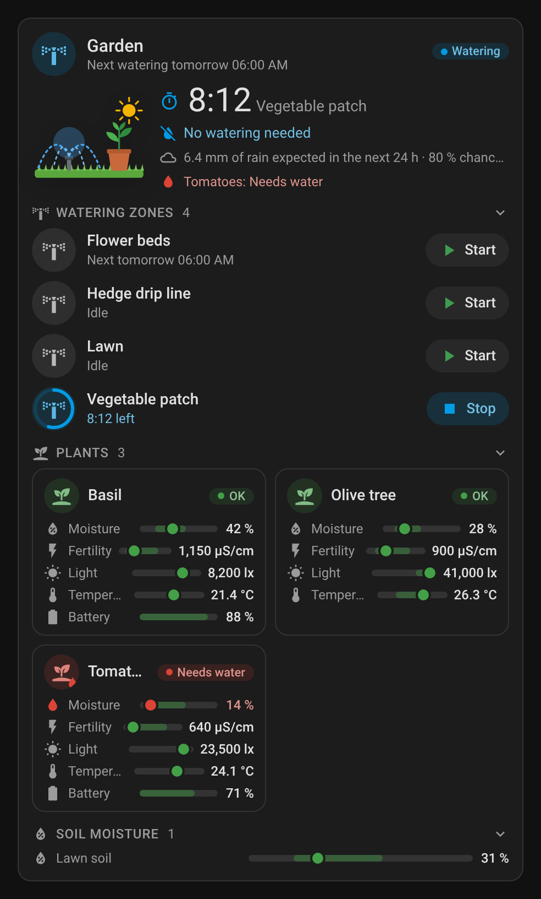 |

Rain expected, nothing watering: the card says watering is not needed, and why:

| Light | Dark |
|---|---|
| 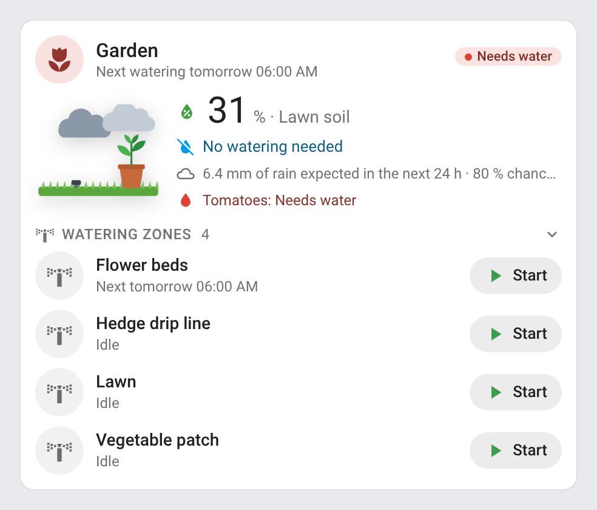 | 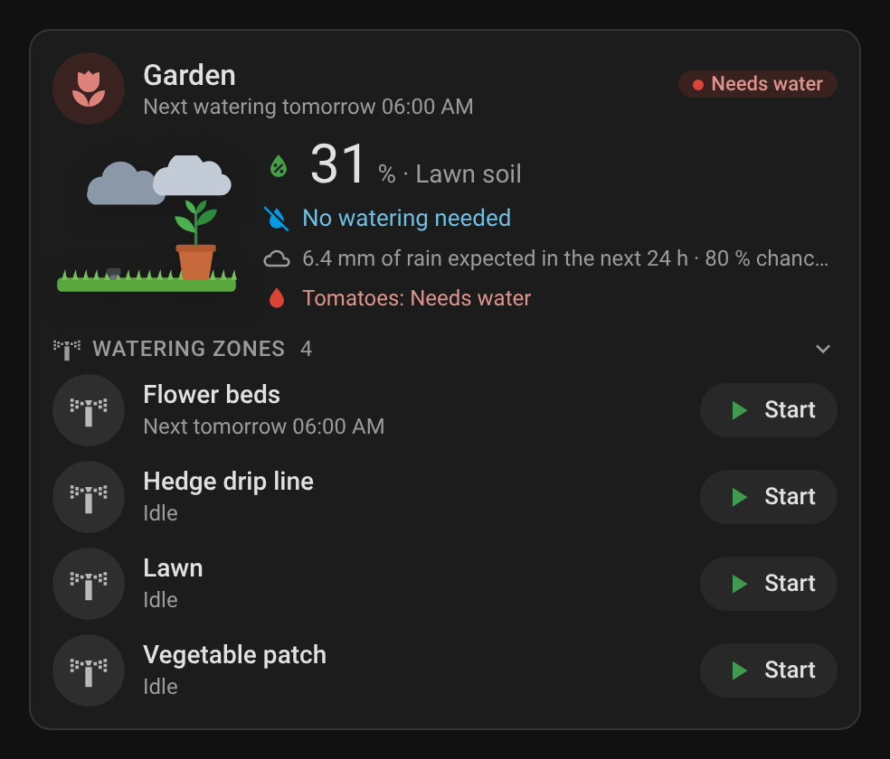 |

Start on a zone: the duration popup, at the top of the card:

| Light | Dark |
|---|---|
| 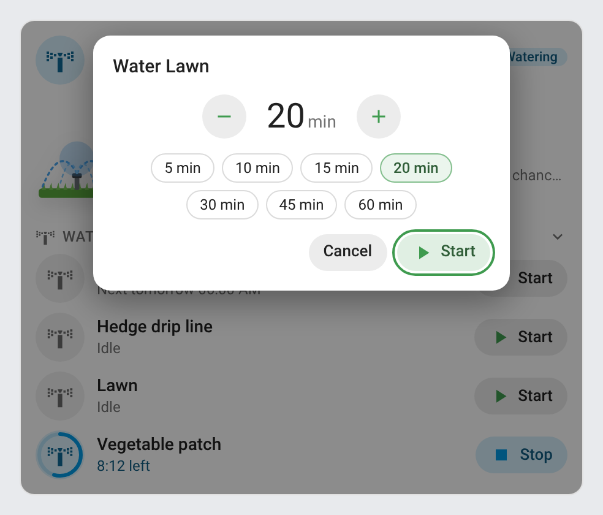 | 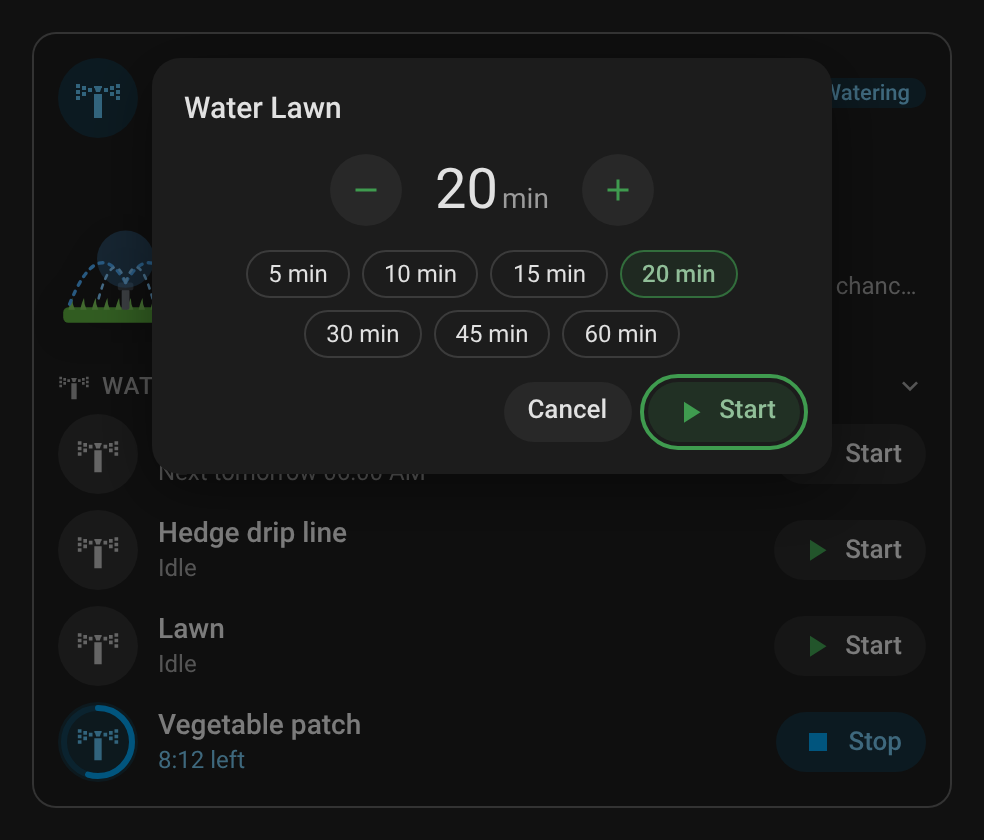 |

Plants with their gauges (the green band is the plant's range), on a dry day:

| Light | Dark |
|---|---|
| 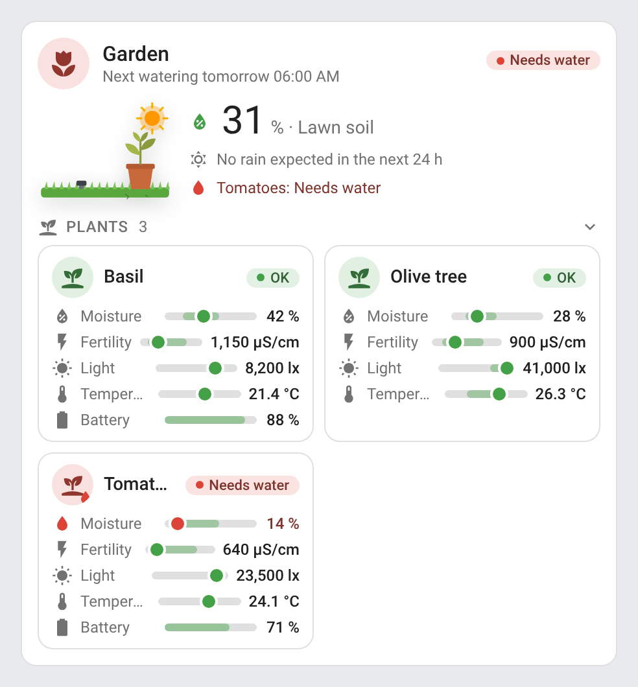 | 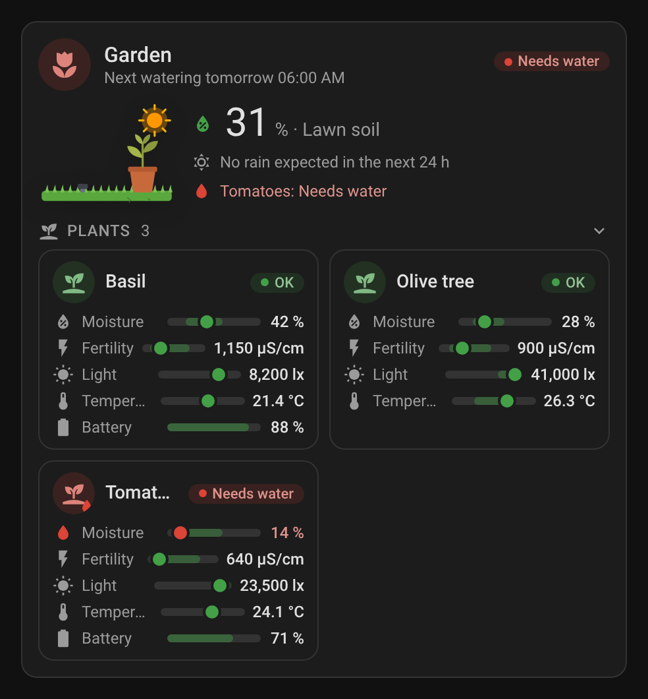 |

### Mini card

| Light | Dark |
|---|---|
|  | 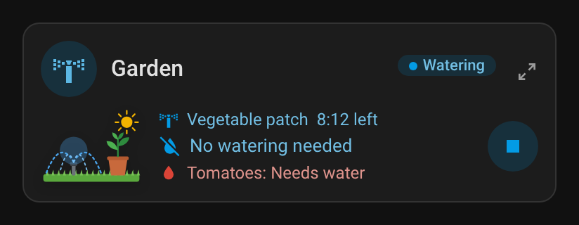 |
|  | 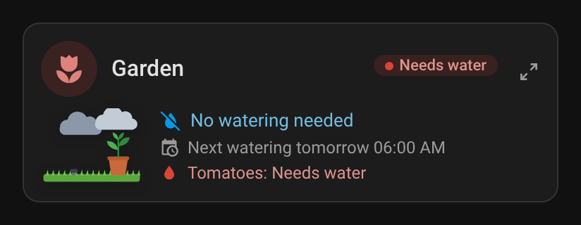 |

The detail button (top right) shows the full card's content:

| Light | Dark |
|---|---|
| 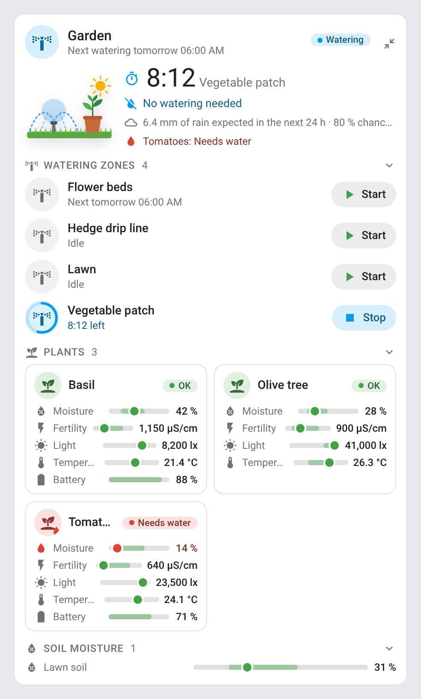 | 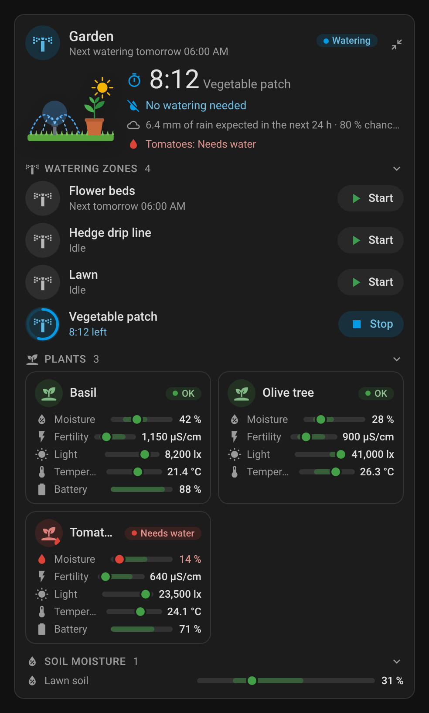 |

### Narrow cards

The full card at 6 columns of a phone's Sections view (the gauge labels give way to the bars, the zone buttons keep their icon) and the mini card at its minimum width:

| Light | Dark |
|---|---|
| 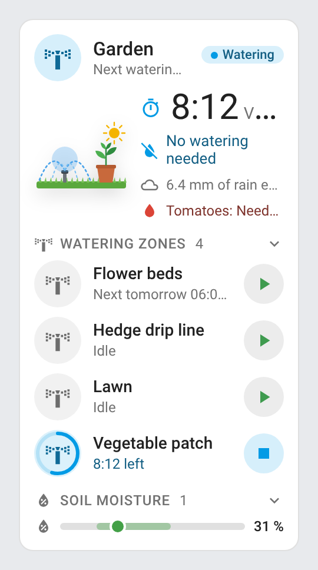 | 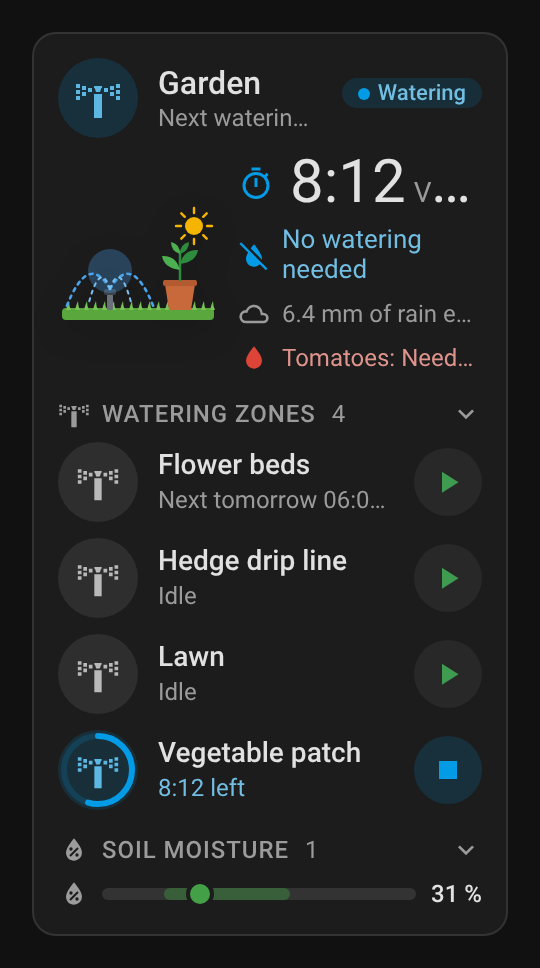 |
| 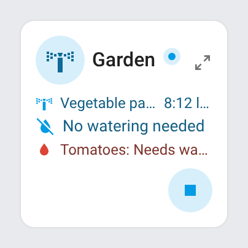 | 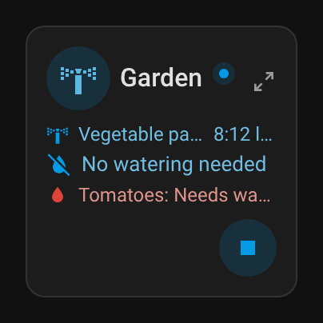 |

## How it works

The cards read the Home Assistant entity and device registries instead of relying on entity ids: a zone is a valve or a switch of a supported integration (OpenSprinkler: its station switches; Rachio and B-hyve: their zone switches, not the rain delay or schedule ones), and its helpers (remaining time, next run, duration number, watering sensor, soil moisture) are the entities of its device recognised by their translation key or name. Entity ids can therefore be in any language or renamed.

- **Countdown**: from the zone's remaining time sensor (a duration counted from its last update, or the timestamp of the end), else from the run the card started. The ring shows what is left of the run: its total duration sensor, the device's duration setting, or the length first seen. The countdown moves every second in place, without redrawing the card.
- **Rain**: the card subscribes to the weather entity's forecast as Home Assistant's own weather cards do (hourly when the entity offers it, else twice daily or daily) and adds up the precipitation of the next `rain_window` hours, each entry for the part of it inside the window. Watering is not needed when that amount reaches `rain_threshold`, when the highest probability reaches `rain_probability` with some rain expected, or when the weather is rainy now. A `rain_sensor` replaces the forecast amount.
- **Plants**: a plant entity of the plant integration gives its readings (attributes) and its verdict (`problem`, e.g. `moisture low`); a Plant Monitor plant gives its sensors and its threshold numbers (`min_soil_moisture`…), found on its device; a device with a soil moisture sensor and a conductivity or illuminance sensor (Mi Flora) is a plant of its own. Light is shown on a logarithmic scale.
- **Soil moisture**: the moisture sensors (device class `moisture`) that belong to no plant and no zone.

## Development

```bash
npm install
npm run build        # bundles src/garden-card.js into dist/garden-card.js (and its translation files)
npm run check        # builds and checks the card (run in CI)
npm test             # unit tests
npm run screenshots  # renders the cards (and one GIF per animated state, needs ffmpeg) with mock data into screenshots/
```

`dist/` is not committed: `npm run build` creates it locally, CI builds it on every push, and the release workflow attaches the built files to the release, which is where the Marketplace installs it from. The captures are rendered on a fixed clock with mock data (scripts/mock-states.mjs) and rewritten only when their pixels change, exactly; on a pull request, the **Screenshots** workflow commits them to the pull request's branch.

### Releasing

1. Bump `version` in `package.json` (and `package-lock.json`, with `npm install`)
2. Add a `## <version>` section at the top of [CHANGELOG.md](https://github.com/juju35/ha-garden-card/blob/main/CHANGELOG.md)
3. Push to `main`: the **Release** workflow builds the card, creates the tag and the GitHub release with the changelog section as notes, and attaches `garden-card.js` and its translation files

## Translations

The cards auto-detect the language from your Home Assistant settings. Currently supported:

| Language | Code |
|---|---|
| English | `en` |
| Français | `fr` |
| Deutsch | `de` |
| Español | `es` |
| Српски | `sr` |
| Srpski (latinica) | `sr-Latn` |
| Italiano | `it` |
| Nederlands | `nl` |
| Português (European; also used for `pt-BR`) | `pt` |
| Polski | `pl` |
| Română | `ro` |
| Dansk | `da` |
| Svenska | `sv` |
| Български | `bg` |
| Русский | `ru` |
| Українська | `uk` |
| Magyar | `hu` |
| Slovenčina | `sk` |
| Čeština | `cs` |
| Slovenščina | `sl` |
| Latviešu | `lv` |
| Ελληνικά | `el` |

English is in the card's file; every other language is in its own small file (`garden-card.i18n.<lang>.js`), loaded only when needed. Contributions for additional languages are welcome!

## Credits

Gardena, Rain Bird, OpenSprinkler, Hunter Hydrawise, LinkTap, Rachio, Orbit B-hyve, Xiaomi and Mi Flora are trademarks of their respective owners. This project is not affiliated with any of them. Icons from [Material Design Icons](https://pictogrammers.com/library/mdi/).

## License

[MIT](https://github.com/juju35/ha-garden-card/blob/main/LICENSE)

## Support

If you find this project useful, you can support its development:

<a href="https://buymeacoffee.com/julienstep9"></a>
